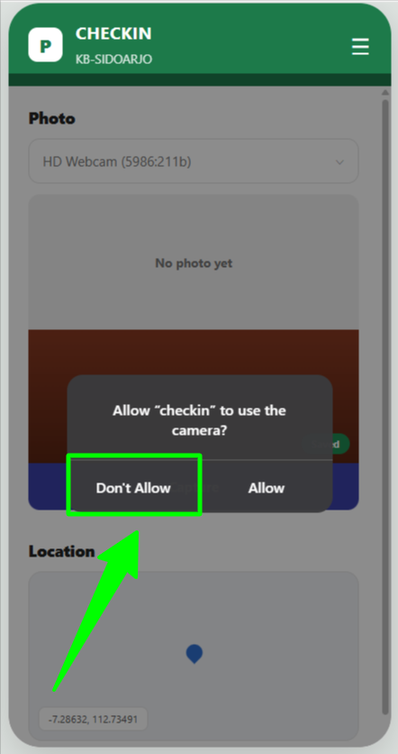

# Checkout

## CO.F1 - User redirect to login page

* Given user visit `/checkin/create` url without signin
* Then user redirected to `Sign In` page

<figure><figcaption></figcaption></figure>

## CO.F2 - Display a text "camera permission blocked"

* Given I already logged in
* And I on the page `/checkin`
* And I have checkin data for date 25 jul 2026
* And the camera permission status is Asking
* When I click button checkout

<figure><figcaption></figcaption></figure>

* And I click Don't Allow on the prompt

<figure><figcaption></figcaption></figure>

* Then I can view error message "Camera access is blocked"

<figure><figcaption></figcaption></figure>

## CO.F3 - Display a text "Location access is blocked"

* Given I already logged in
* And I on the page `/checkin`
* And the location permission status is asking
* When I click button checkout

<figure><figcaption></figcaption></figure>

* When I click Don't allow on the prompt

<figure><figcaption></figcaption></figure>

* Then I can view notification "Location access is blocked"

<figure><figcaption></figcaption></figure>

## CO.F4 - Photo not captured. Please take a photo before continuing

* Given I already logged in
* And I on the page `/checkin`
* And I have granted camera access permission
* And I have check-in data for the same date as the check-out
* When I click button checkout

<figure><figcaption></figcaption></figure>

* And I click submit button without take any photos

<figure><figcaption></figcaption></figure>

<figure><figcaption></figcaption></figure>

* Then I can view notifications "photo not capture. please take a photo before continuing"

<figure><figcaption></figcaption></figure>

## CO.F5 - Location not found. Make sure GPS & internet are turned on, then try again

* Given I already logged in
* And I on the page `/checkin`
* and I have granted access permission for the camera
* and I did not grant GPS access permission
* and I have check-in data for the same date as the check-out
* When I click button checkout

<figure><figcaption></figcaption></figure>

* And I click capture

<figure><figcaption></figcaption></figure>

* And I click submit

<figure><figcaption></figcaption></figure>

* Then I can view notification "Location not found. Make sure GPS & internet are turned on, then try again"

<figure><figcaption></figcaption></figure>

## CO.S1 - Checkout success, redirect to feed page

* Given I already logged in
* And I on the page `/checkin`
* And the camera permission status is Asking
* And the location permission status is asking
* And I have check-in data for the same date as the check-out
* When I click button checkout

<figure><figcaption></figcaption></figure>

* When I click Allow on the camera prompt

<figure><figcaption></figcaption></figure>

* And I click Allow on the location prompt

<figure><figcaption></figcaption></figure>

* And I click capture

<figure><figcaption></figcaption></figure>

* And I type absensi berhasil into column notes

<figure><figcaption></figcaption></figure>

* And I click submit

<figure><figcaption></figcaption></figure>

* Then I can redirect to feedpage to see checkout data


Note : Untuk tampilan feed absensi mengikuti tampilan app saat ini. _yang dirubah hanya tombol bawah._


* And I can see my check out data with the following fields:

| Field     | Value                |
| --------- | -------------------- |
| Full Name | Nur Aini             |
| Username  | @nrainii             |
| Location  | 429812138, 239428323 |
| Notes     | Check-in successful  |
| Date      | 25 Jul 2026          |
| Time      | 08:00                |
| Photo     | Captured photo       |

<figure><figcaption></figcaption></figure>

* And I can see button checkin

<figure><figcaption></figcaption></figure>
